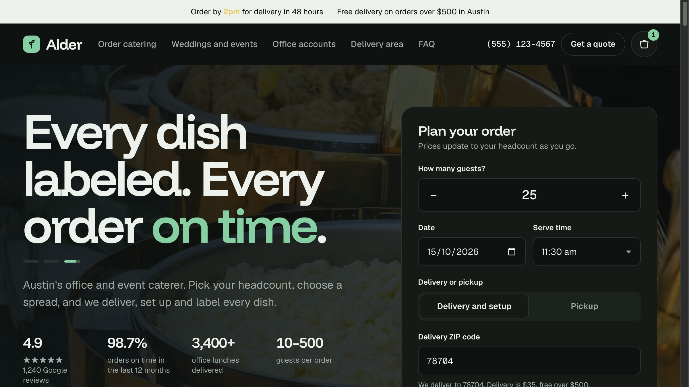
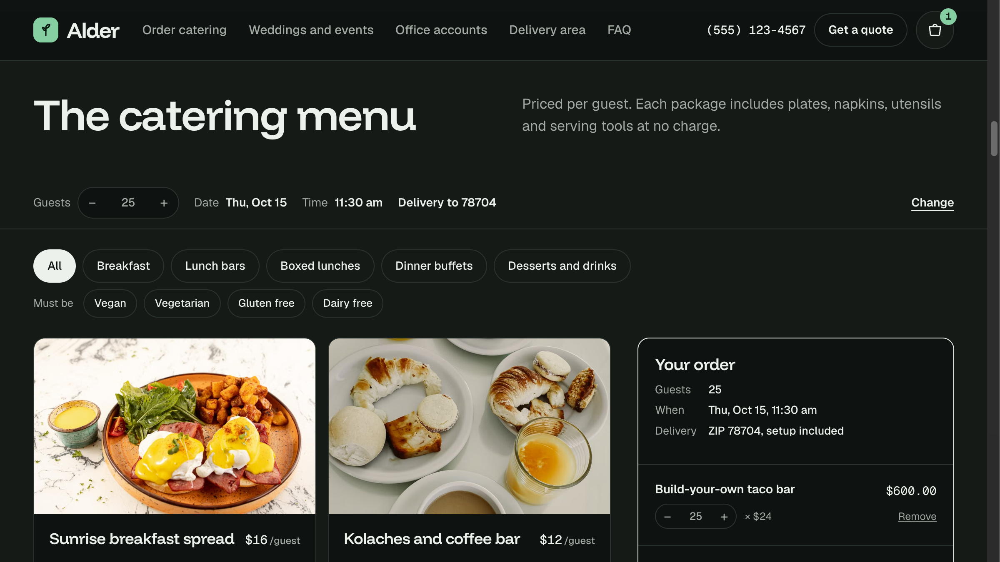
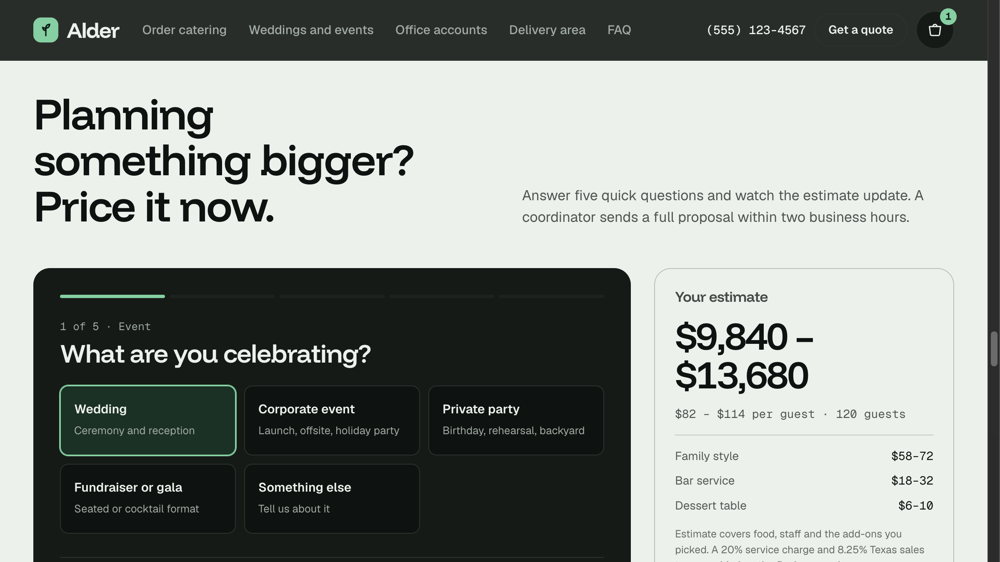
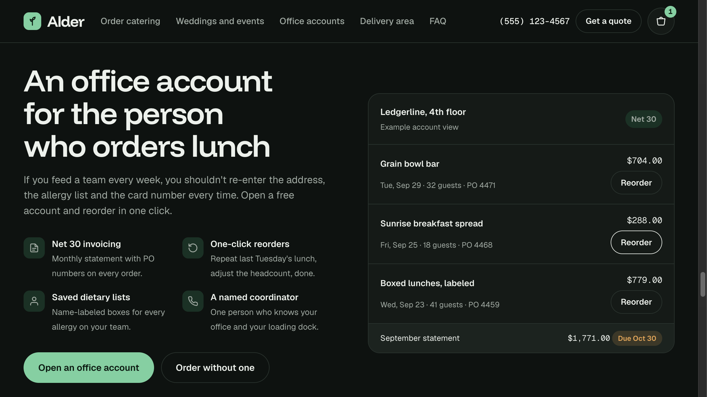
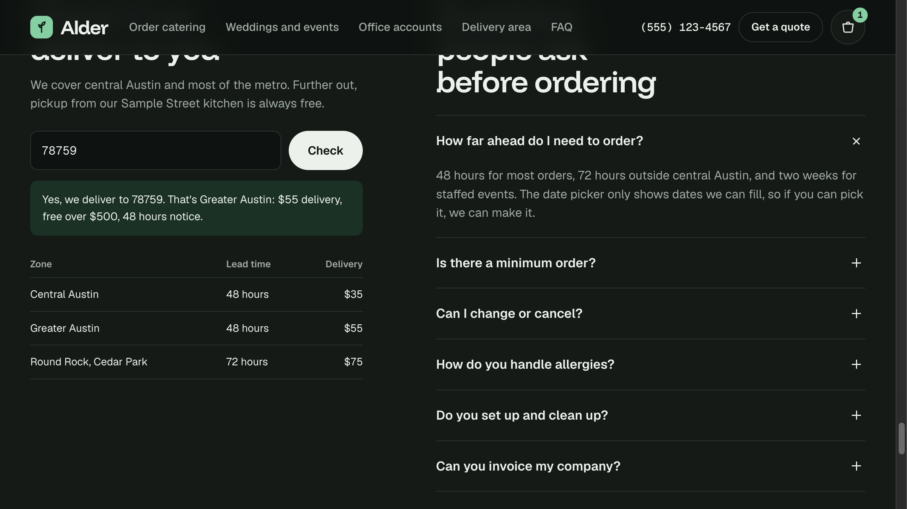
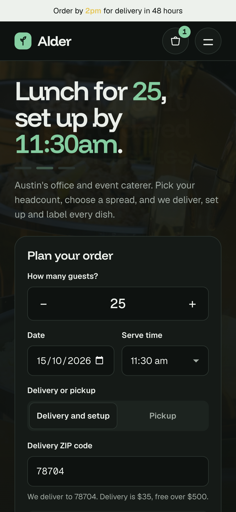
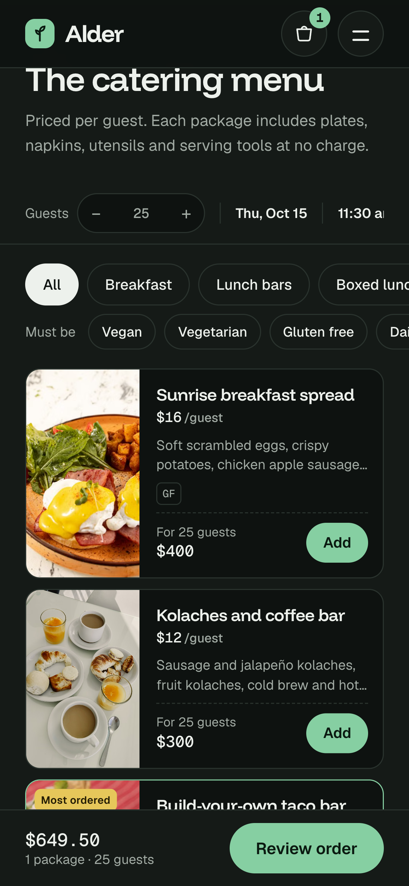
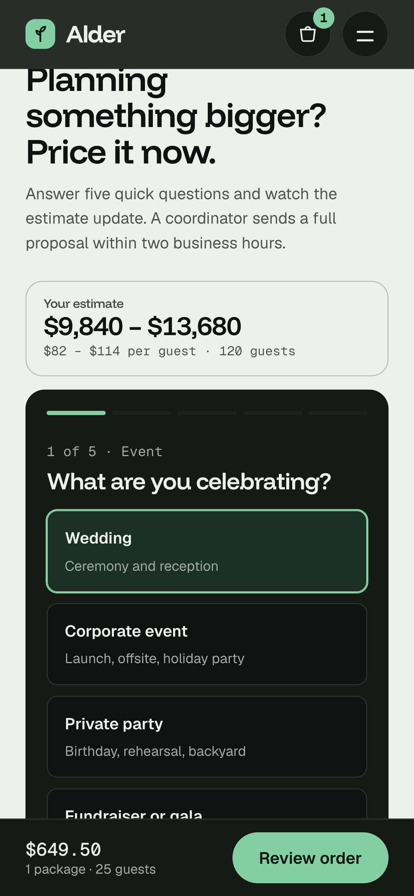

# Alder Catering — 1:1 Clone Spec

**Source:** `https://freshbakes.store/aldercatering/`
**Page title:** `Alder Catering | Office and event catering in Austin`
**Meta description:** `Office lunches, corporate events and weddings in Austin. Pick your headcount, choose a spread and order catering online in two minutes.`
**Goal:** Rebuild this page pixel-close, desktop + mobile, with all interactive logic client-side only (no backend). This file + `screenshots/` is the single source of truth.

---

## 0. Visual reference — READ THESE FIRST

All screenshots were captured from the live site with Chrome DevTools and saved in this repo:

### Desktop (1440px)

*Fig 1 — `01-hero-desktop.png` — Top viewport: announcement bar, sticky header, rotating H1, planner card, trust stats, photo mosaic.*


*Fig 2 — `02-fullpage-desktop.png` — Full-page scroll: every section in order.*


*Fig 3 — `03-menu-desktop.png` — Menu grid + sticky order sheet on right.*


*Fig 4 — `04-events-quote-desktop.png` — Dark quote-builder section with live estimate.*


*Fig 5 — `05-corporate-reviews-desktop.png` — Office-account mock + 3 review cards.*


*Fig 6 — `06-delivery-faq-footer-desktop.png` — ZIP checker, zone table, FAQ accordion, green final CTA, footer.*

### Mobile (390×844, iPhone)

*Fig 7 — `07-hero-mobile.png` — Mobile hero: H1 → sub → planner card → horizontal trust scroller. Mosaic becomes swipe row.*


*Fig 8 — `08-menu-mobile.png` — Mobile menu: sticky event strip, chip scrollers, horizontal 108px-thumb cards.*


*Fig 9 — `09-events-mobile.png` — Mobile quote: estimate pinned sticky on top, form below.*

> Agent workflow: open Fig 1→9 side-by-side while building. Match spacing, type scale, and card anatomy exactly.

---

## 1. Global design system

### 1.1 Fonts (Google Fonts — must load these exact families)
```html
<link href="https://fonts.googleapis.com/css2?family=Funnel+Display:wght@500;600;700&family=Geist:wght@400;500;600&family=Geist+Mono:wght@400;500&display=swap" rel="stylesheet">
```
- Display / headings: `"Funnel Display", "Avenir Next", "Segoe UI", system-ui, sans-serif` — weight 600, `letter-spacing: -0.025em` to `-0.045em`, `line-height: 1.05` (hero 0.95).
- Body: `"Geist", "Helvetica Neue", Arial, system-ui, sans-serif` — 16px desktop / 15.5px mobile, `line-height: 1.55`.
- Numbers / tabular: `"Geist Mono", ui-monospace, "SF Mono", Menlo, monospace` — class `.num`, `font-variant-numeric: tabular-nums`. Used for ALL prices, counts, times, ZIPs.

### 1.2 Colors — light (default) + dark (prefers-color-scheme)
Light (`:root`):
```
--bg:#F6F7F3  --surface:#FFFFFF  --tint:#ECEFE8
--ink:#121714  --muted:#58615B  --line:#D9DED5
--accent:#1D5A3D (deep green button)  --accent-ink:#FFFFFF
--accent-soft:#DCE9DF  --butter:#F1D36A  --butter-ink:#2B2306
--warn:#9A5B12  --ok:#1D5A3D
```
Dark (`@media prefers-color-scheme: dark` + `[data-theme="dark"]`):
```
--bg:#0E1210  --surface:#151A17  --tint:#1C231F
--ink:#EDF1EC  --muted:#A1AAA3  --line:#2A332E
--accent:#86CFA2 (mint)  --accent-ink:#0B1A11
--accent-soft:#1B3125  --butter:#E6C75A  --butter-ink:#231C04
--warn:#E2A65A
```
Body during capture was dark: `bg rgb(14,18,16), color rgb(237,241,236)`. **Implement both themes with CSS vars + `color-scheme: light/dark`.**

### 1.3 Shape, spacing, buttons
- `--gut:24px` mobile, `40px` ≥900px. `.wrap{max-width:1240px; margin-inline:auto; padding-inline:var(--gut)}`
- Radius: `--r:14px` cards, `--r-sm:10px` inputs, pills `999px`.
- Section padding: `clamp(64px,9vw,120px)` desktop, `56px` mobile. Section H2: `clamp(2rem,4.4vw,3.4rem)`, mobile `clamp(1.85rem,8.4vw,2.4rem)`.
- Buttons `.btn`: `min-height:52px, padding 0 24px, radius 999px, weight 600, 15.5px`. Variants: `.btn-primary` (accent bg), `.btn-ghost` (1px line border), `.btn-ink` (ink bg), `.btn-sm` (40px). Hover: primary `brightness(1.08)`, ghost border→ink. Active `scale(.98)`.
- Inputs `.input`: `min-height:50px, border 1px var(--line), radius 10px, bg var(--bg), padding 0 14px`. Focus: `border accent + 0 0 0 3px accent-soft`. Select has custom double-chevron.
- `:focus-visible{outline:2px solid var(--accent); outline-offset:3px}`.
- `html{scroll-behavior:smooth}` (disable on reduced-motion).

---

## 2. Page skeleton (in order)

```
.announce
header.site (sticky)
main#top
  section.hero (bg img + hero-grid + mosaic)
  .logos strip
  section.sec (3 steps)
  section#menu.sec.menu-sec (eventbar + filters + menu-grid[ pk-grid + aside.sheet ])
  section#occasions.sec (4 occ-cards)
  section#events.sec.quote-sec (dark, qb-form + est)
  section#corporate.sec (perks + acct mock)
  section.sec (reviews)
  section.sec.split (#delivery zone + #faq faq-col)
  section.final (green CTA)
footer.site
.mbar (mobile fixed order bar)
.scrim > .drawer (checkout drawer)
.toast
.nav-sheet (mobile nav)
```

---

## 3. Announcement + Header

Announcement (`.announce`, ink bg, bg-color text, 13.5px centered):
> `Order by **2pm** for delivery in 48 hours` + `Free delivery on orders over $500 in Austin` — mobile hides second span.

Header (`header.site`, sticky top 0, z 40, `bg color-mix(bg 88%, transparent) + blur(14px) saturate(1.4)`, 1px bottom line, height `--hh:72px` desktop / `64px` mobile):
- Left: logo `Alder` — 26px Funnel 700 + 30px rounded-square accent mark with leaf SVG (two leaves + stem, stroke currentColor accent-ink).
- Center nav (≥1000px only): `Order catering → #menu`, `Weddings and events → #events`, `Office accounts → #corporate`, `Delivery area → #delivery`, `FAQ → #faq` — 15px/500 muted, hover ink.
- Right: phone `(555) 123-4567` (`tel:+15551234567`, ≥1000px), ghost small `Get a quote → #events`, cart button (46px circle, basket SVG, green count badge `1` seeded), burger (≤999px, two lines → X on open).
- Mobile nav sheet: full-screen below header, big Funnel links (1.75rem) each with sub-caption, footer with quote button + phone note. Closes on link / Escape / ≥1000px resize.

---

## 4. Hero


Container: `position:relative; isolation:isolate; overflow:hidden; padding 36–72px top, 40–64px bottom`.
Background: `.hero-bg img` = `https://images.pexels.com/photos/12253094/pexels-photo-12253094.jpeg?auto=compress&cs=tinysrgb&w=1920` (empty alt), `object-fit:cover, opacity:.42` (mobile `.3`), overlay gradients to bg (see CSS). Must keep text readable in both themes.

Grid: `1.15fr / .85fr` ≥1000px, stacked mobile with `display:contents` trick — order on mobile: H1 → dots → sub → **planner (order:5)** → **trust (order:6)** → mosaic.

### 4.1 Rotating H1 (`#heroRot`, `clamp(2.75rem,7.2vw,5.9rem)`, mobile `clamp(2.45rem,11.4vw,3.3rem)`)
3 slides cross-fade/slide (`opacity .6s, translateY 18px`), auto-rotate 5s, dots (28×4px bars, active has green fill animation `rotfill 5s linear`):
1. `Lunch for 25, set up by 11:30am.` — `#hMeal` (Breakfast <10:30am / Lunch <3pm / Dinner else), `#hGuests`, `#hTime` in accent color, bump animation on change. Dots label `Headline 1`.
2. `Catering for 10 to 500, ordered in two minutes.`
3. `Every dish labeled. Every order on time.`
Any planner headcount/time change jumps back to slide 1 + restarts timer. `prefers-reduced-motion` disables slide movement.

Sub: `Austin's office and event caterer. Pick your headcount, choose a spread, and we deliver, set up and label every dish.` (muted, max 44ch).

Trust row (4 cols desktop → horizontal snap scroller mobile):
- `4.9 ★★★★★ / 1,240 Google reviews`
- `98.7% / orders on time in the last 12 months`
- `3,400+ / office lunches delivered`
- `10–500 / guests per order`
Strong = Funnel 1.6rem (1.35rem mobile), label 13px muted.

### 4.2 Planner card (`form#planner.planner`)
White/surface card, 1px line, radius 22px (20px mobile), padding 28px (20px mobile), column gap 18px (14px mobile). Title `Plan your order` 1.5rem + sub `Prices update to your headcount as you go.` (hidden mobile).

Fields:
- `How many guests?` — stepper: `− | 25 | +` (52px buttons, mono 22px input, `min 8 max 500`, steps ±5). Clamps + rescales cart lines that follow headcount.
- Row2: `Date` (date input, min = earliest +48h / +72h for far zones, max +120d, Sundays skipped, default = nearest weekday) + `Serve time` (select 7:00am–7:00pm half-hours, default `11:30 am`).
- `Delivery or pickup` segmented (`.seg`, tint bg): `Delivery and setup` (pressed) / `Pickup`. Toggles ZIP field visibility.
- `Delivery ZIP code` (`#pZip`, mono, 5-digit, default `78704`) + hint: `We deliver to 78704. Delivery is $35, free over $500.` (warn color if invalid).
- Lead note (tint box, clock icon): `Earliest date is 48 hours out. Need it sooner? Call us and we'll try.` → `Your area needs 72 hours notice...` for 72h zones.
- Submit `.btn-primary` full-width: `See the menu for 25 guests` (count live) → smooth-scrolls to `#menu`.
- Foot: `Wedding or 100+ guests? Get a custom quote → #events`.

### 4.3 Mosaic (3 photos, 6-col grid → swipe row mobile)
- 1: `Catering buffet with chafing dishes...` `.../32689477/...w=1400` — spans 3 cols desktop (16/9 mobile 78% width).
- 2: `Bright grain bowl with vegetables` `.../34227771/...w=900`.
- 3: `Group of people sharing a meal` `.../6995246/...w=700`.
Desktop: col spans 3/2/1, min-height 340px first. Cards radius 14px, caption hidden when img loads. Mobile: `flex overflow-x snap, each 78% 4/3`.

---

## 5. Logos strip + 3 steps

Logos (`.logos`, top/bottom line, 26px pad): label `Feeding teams at` + wordmarks `Ledgerline` (Funnel 700), `Mesa Health` (same), `caliche/studio` (Georgia italic serif), `Riverbend Law` (serif?), `Tessellate` (mono 17px). All muted 85% opacity. Mobile: horizontal scroller, nowrap.

Steps section H2: `Ordering for 40 should take two minutes` + lead: `Everything a catering coordinator would ask you on the phone is built into the order. You get a confirmed time, a fixed price and an order sheet you can forward to finance.`
3 cols (border-top 2px ink each):
1. `Step 1 / Set your headcount and time / We only show dates we can actually deliver, and we scale every package to your guest count.`
2. `Step 2 / Pick a spread or two / Filter by vegan, gluten free or dairy free. Every dish arrives labeled with allergens.`
3. `Step 3 / Pay or invoice, then relax / Card at checkout, or Net 30 invoicing on an office account. We text the driver's ETA on the day.`
Mobile: rows with `n` 56px left, h3 1.15rem, p indented 70px.

---

## 6. Menu + Order system (core — see Fig 3)


Section `#menu.sec.menu-sec` — surface bg, top/bottom line.

### 6.1 Sticky event bar (`#eventbar`, sticky under header z20)
Shows live: `Guests [− 25 +] | Date Thu, Oct 15 | Time 11:30 am | Delivery to 78704 | Change → #top`. Mobile: nowrap scroller, hide date label. Mini stepper `34px 52px 34px / 38px pill`.

### 6.2 Filters
Category chips: `All (pressed) / Breakfast / Lunch bars / Boxed lunches / Dinner buffets / Desserts and drinks` — pill 40px, pressed = ink bg + bg text.
Diet row: label `Must be` + `Vegan / Vegetarian / Gluten free / Dairy free` (34px small chips, AND logic). Empty state: `Nothing in this course matches every filter. [Clear dietary filters]`.

Category mapping: `breakfast: sunrise,kolache | lunch: tacos,bowls,mezze | boxed: boxed | dinner: brisket,salmon | sweet: sweets,drinks`.

### 6.3 Packages — exact data (10 items)
`VG=Vegan, V=Vegetarian, GF=Gluten free, DF=Dairy free`. `pp` = $/guest, `min` = min headcount. Image base `https://images.pexels.com/photos/{id}/pexels-photo-{id}.jpeg?auto=compress&cs=tinysrgb&w=800`.

| Name | $/guest | Desc (verbatim) | Diets | Tag | img id | min | 25-guest total |
|---|---|---|---|---|---|---|---|
| Sunrise breakfast spread | $16 | Soft scrambled eggs, crispy potatoes, chicken apple sausage, seasonal fruit and salsa verde. | GF | — | 16556113 | 10 | $400 |
| Kolaches and coffee bar | $12 | Sausage and jalapeño kolaches, fruit kolaches, cold brew and hot coffee with oat milk. | — | — | 34232215 | 12 | $300 |
| Build-your-own taco bar | $24 | Chipotle chicken, carnitas and roasted cauliflower with corn tortillas, rice, beans and three salsas. | GF DF | Most ordered | 8448339 | 15 | $600 |
| Grain bowl bar | $22 | Farro and brown rice, roasted vegetables, lemon chicken or crispy tofu, and four sauces on the side. | VG V GF DF | — | 1640770 | 10 | $550 |
| Mediterranean mezze | $21 | Chicken shawarma, falafel, hummus, tabbouleh, cucumber salad and warm pita. | V | — | 5944 | 10 | $525 |
| Labeled boxed lunches | $19 | A sandwich or salad, side, cookie and drink in a box with each guest's name on it. | V | — | 5852322 | 8 | $475 |
| Smoked brisket buffet | $32 | 12-hour brisket, smoked chicken, mac and cheese, slaw, pickles and Texas toast. | — | Austin favorite | 9397270 | 20 | $800 |
| Lemon herb salmon dinner | $38 | Roasted salmon, herbed potatoes, charred broccolini and a little gem Caesar. | GF | — | 1516415 | 15 | $950 |
| Cookie and bar tray | $6 | Brown butter chocolate chip, lemon bars and fudgy brownies. Two pieces per guest. | V | — | 1775283 | 12 | $150 |
| Agua fresca and sparkling water | $5 | Two seasonal agua frescas and still and sparkling water, iced and ready. | VG V GF DF | — | 8215115 | 10 | $125 |

Card anatomy (`.pk`, bg bg, 1px line, radius 14, hover border-ink, in-cart border-accent):
- Photo 16/10 + tags top-left (`.tag.pop` butter bg for Most ordered / Austin favorite) + diet badges (mono 11px bordered).
- Body: `h3 1.2rem + .pp mono ($16<small>/guest</small>)` top row, `desc 14.5px muted`, foot (dashed top border): `For 25 guests <b>$400</b>` (or `Min X guests` in warn if below min) + `Add to order` pill (accent). Added state: `Added ✓` (accent-soft bg).
- Mobile: `grid 108px | 1fr`, thumb full-height min 150px, h3 1.02rem, desc 2-line clamp, Add 38px.

### 6.4 Order sheet / cart math (MUST replicate exactly)
Seeded state: `tacos × 25` in cart on load (badge `1`).

- Desktop aside `.sheet` (sticky top 150px, 1px ink border, 380px col, ≥1080px only): head `Your order` + `Guests 25 / When Thu, Oct 15, 11:30 am / Delivery ZIP 78704, setup included`, lines (name, price right, qty mini-stepper + `× $24`, Remove), totals.
- Mobile: fixed bottom `.mbar` (slides up only when cart>0 AND planner not visible via IntersectionObserver): ` $649.50 / 1 package · 25 guests / [Review]`. Hidden on drawer/nav open, ≥1080px `display:none`.
- Drawer (`.scrim > .drawer` 520px right desktop / bottom-sheet 92dvh mobile with grab handle): `Your order` + meta + editable lines + toggles (e.g. utensils?) + `Continue to payment · $X` + order-sheet summary. `Esc` / scrim click / X closes, focus trapped-ish, body scroll locked.

Math constants: `MIN_ORDER=250, FREE_DEL=500, TAX=0.0825`.
```
sub = Σ(pp × qty)
delivery = 0 if pickup or invalid ZIP; else 0 if sub≥500 else zone fee (35/55/75)
tax = (sub+delivery) × 0.0825
total = sub+delivery+tax
per-guest = total / guests
```
Example seeded (25 guests, tacos, 78704 Central): `Subtotal $600.00 / Delivery Free (over $500) / Tax $49.50 / Total $649.50 / $25.98 per guest`.
Progress bars: if `sub<250`: `Add $X more to reach the $250 delivery minimum.` (+ fill `sub/250`). Else if delivery mode + valid ZIP + `sub<500`: ` $X away from free delivery.` Review/Checkout disabled while `sub<250` (label `Add $X to continue` / `Add a package to continue`).
Qty rules: new line `qty = max(pkg.min, guests) + follow:true`; headcount change rescales `follow` lines; manual ± sets `follow:false`, floor = `pkg.min` (toast `needs at least X servings` if hit). Remove deletes line. Toasts: `Added for X guests.` bottom-center ink pill 2.8s. Checkout button toast (demo): `Demo: on Shopify this opens checkout with the event details attached to the order.`

ZIP logic (`zipInfo`):
- `Central Austin $35 48h`: 78701–78705, 78712, 78722, 78751, 78756
- `Greater Austin $55 48h`: 78706–78759 (others in range)
- `Round Rock and Cedar Park $75 72h`: 78613, 78664, 78665, 78681, 78641 (date min → +3d)
- Else invalid: `We don't deliver to {z} yet. Pickup from our Sample Street kitchen is free...` / `Enter a 5-digit ZIP code.`

---

## 7. Occasions (4 cards)

H2 `One kitchen, every kind of gathering` + `Drop-off for the weekly team lunch, full staff for the gala. Same food, same standards, priced up front.`
Grid 4 (2 tablet, swipe-row mobile 80%):

1. img `.../5852271/...w=800` `Sandwiches and salads packed for an office lunch` / `Office lunches / Drop-off spreads and individually labeled boxes, set up in your break room. / From $16 per guest / Order now → #menu`
2. img `.../34321369/...` `Evening corporate event with string lights` / `Corporate events / Launches, offsites and client dinners with servers, bar and rentals handled. / From $42 per guest / Get a quote → #events`
3. img `.../27495819/...` `Wedding reception tables set for dinner` / `Weddings / Family style, plated or stations. A tasting for two is included once you book. / From $58 per guest / Get a quote → #events`
4. img `.../57980/...` `Plated dish at a private dinner` / `Private parties / Birthdays, rehearsal dinners and backyard parties from 20 guests. / From $28 per guest / Get a quote → #events`
Card: surface, line border, radius 14, photo 4/3, body 18px pad, meta row (price mono + accent arrow link).

---

## 8. Quote builder (dark section — Fig 4)


`section#events.quote-sec` — bg `var(--ink)`, text `var(--bg)`, muted = 70% mix. H2 `Planning something bigger? Price it now.` + `Answer five quick questions and watch the estimate update. A coordinator sends a full proposal within two business hours.`
Grid: form 1fr + 360px estimate (mobile: estimate sticky compact on top, order -1).

Form (`.qb-form`, surface bg ink text, radius 20, 32px pad / 20px mobile): progress 5 bars, step label `1 of 5 · Event` (mono), H3 per step, tiles, nav Back/Continue (Continue full-width mobile).

Steps:
1. `What are you celebrating?` tiles (2-col, 3-col ≥700px): Wedding/Ceremony and reception (pressed default), Corporate event/Launch offsite holiday, Private party/Birthday rehearsal backyard, Fundraiser or gala/Seated or cocktail, Something else/Tell us about it.
2. `How many guests, and when?` — range 20–500 step 5 default 120 (big Funnel 2.6rem output) + date (default +200d, min +14d) + Venue/city (default `Dripping Springs`). Note `Staffed events need two weeks notice.`
3. `How should we serve it?` — Drop-off buffet/Set up no staff $28–36, Staffed buffet/Servers and breakdown $42–55, Family style/Shared platters $58–72 (default), Plated dinner/Coursed $72–95, Chef stations/Carving pasta tacos $62–80.
4. `Anything else to handle?` check-tiles (default Bar + Dessert): Bar service/Bartenders mixers ice +$18–32, Rentals/Linens china +$9–14, Dessert table/Minis +$6–10, Late-night snack/Sliders 10pm +$8–12.
5. `Where should we send the proposal?` — Name (`Priya Shah` ph), Email, Phone optional, Food budget per guest (Not sure/Under $40/$40–70/$70–100/$100+), Notes (`Dietary needs, cuisine...`). Validate: name required, email regex, warn-color errors.

Estimate (`.est`, bordered card, sticky top 96px): `Your estimate / $9,840 – $13,680` (Funnel 2.9rem, tabular) / `$82 – $114 per guest · 120 guests` / dl rows (Family style $58–72, Bar $18–32, Dessert $6–10) / note `Estimate covers food, staff and the add-ons you picked. A 20% service charge and 8.25% Texas sales tax are added on the final proposal.` / person `JM / Jordan Meyer / Events lead. Replies to every quote personally.` (butter avatar).
Math: `lo/hi = Σ(style + addons) × factor (×1.12 if <40, ×0.94 if ≥200)`, total = `round10(perGuest × guests)`. Success view: green tick + `Got it, {first}. Jordan will email {email} a full proposal...` + `Start another quote`.

---

## 9. Corporate, Reviews, Delivery/FAQ, Final, Footer

### Corporate (`#corporate`, 2-col ≥1000px)
H2 `An office account for the person who orders lunch` + `If you feed a team every week, you shouldn't re-enter the address, the allergy list and the card number every time. Open a free account and reorder in one click.`
4 perks (36px accent-soft icon + b/span): `Net 30 invoicing / Monthly statement with PO numbers.` / `One-click reorders / Repeat last Tuesday's lunch, adjust the headcount, done.` / `Saved dietary lists / Name-labeled boxes for every allergy.` / `A named coordinator / One person who knows your office and loading dock.`
CTAs: `Open an office account` (primary, toast demo) + `Order without one → #menu`.
Right mock (`.acct`, surface, radius 20): head `Ledgerline, 4th floor / Example account view / Net 30 pill` + rows (`Grain bowl bar / Tue, Sep 29 · 32 guests · PO 4471 / $704.00 [Reorder]`, `Sunrise breakfast spread / Fri, Sep 25 · 18 guests · PO 4468 / $288.00 [Reorder]`, `Boxed lunches, labeled / Wed, Sep 23 · 41 guests · PO 4459 / $779.00 [Reorder]` — Reorder adds to cart + toast) + foot `September statement $1,771.00 Due Oct 30`.

### Reviews
Top: big `4.9` (4rem Funnel) + `★★★★★` butter + `1,240 reviews on Google` + H2 `What the people who order say`. 3 cards (surface, radius 14, 24px pad):
1. `"Lunch for 60 used to take me three phone calls. Now it takes five minutes, and the setup is finished before I get downstairs."` — DR / Dana R. / Office manager, Ledgerline / `Weekly order · 60 guests · since 2024`
2. `"They gave us a real number on day one. The final invoice was within $90 of the estimate, and our guests are still talking about the brisket."` — PS / Priya and Sam / Wedding, Dripping Springs / `Family style · 140 guests · May 2026`
3. `"Our board lunch had nine different allergies. Every box came labeled with a name. Nobody had to ask a single question."` — MT / Marcus T. / Executive assistant, Mesa Health / `Boxed lunches · 22 guests · Aug 2026`
Avatar 38px tint circle initials. Mobile swipe-row 86%.

### Delivery + FAQ (`.split`, 0.9/1.1fr ≥1000px)
Left `#delivery.zone`: H2 `Check if we deliver to you` + `We cover central Austin and most of the metro. Further out, pickup from our Sample Street kitchen is always free.` + ZIP form (mono input default `78759` + Check button) + result box (`Yes, we deliver to 78759. That's Greater Austin: $55 delivery, free over $500, 48 hours notice.` — ok = accent-soft bg) + table: `Zone/Lead time/Delivery`: Central Austin/48h/$35, Greater Austin/48h/$55, Round Rock Cedar Park/72h/$75.
Right `#faq.faq-col`: H2 `Questions people ask before ordering` + accordion (6 `<details>`, first open, plus/minus ::after, 20px padding):
1. `How far ahead do I need to order?` → `48 hours for most orders, 72 hours outside central Austin, and two weeks for staffed events. The date picker only shows dates we can fill, so if you can pick it, we can make it.`
2. `Is there a minimum order?` → `Delivery orders start at $250. Most packages also have a minimum headcount, shown on each card, so the food arrives in full trays rather than half portions.`
3. `Can I change or cancel?` → `Change headcount up to 24 hours before delivery at no cost. Cancel more than 48 hours out for a full refund. Inside 48 hours we charge 50%, since the food is already ordered.`
4. `How do you handle allergies?` → `Every dish is labeled with the top nine allergens. Add names and needs at checkout and we will pack individually labeled meals at no extra charge.`
5. `Do you set up and clean up?` → `Delivery orders include setup with disposable chafers or cold display. Staffed events include servers, setup, breakdown and trash removal.`
6. `Can you invoice my company?` → `Yes. Office accounts get Net 30 terms with PO numbers. One-off orders can pay by card, Apple Pay or Google Pay at checkout.`

### Final CTA + Footer
`.final` — accent bg, accent-ink text, `clamp(64px,9vw,112px)` pad: H2 `Feed the team on Thursday.` (`clamp(2.5rem,7vw,5.5rem)`, mobile 11vw) — `{DayName}` is dynamic (day of planner date). Sub `Pick the headcount, pick the food, done in two minutes. Your order sheet lands in your inbox right after checkout.` Buttons: `Start an order → #menu` (accent-ink bg) + `Get an event quote → #events` (ghost).
Footer (`.site`, 56–64px pad, 120px bottom mobile for mbar): 4-col grid (brand + Order/Events/Contact): brand `Alder` + `Catering kitchen at 1234 Sample Street, Austin, TX 78704. Open for pickup 7am to 7pm, Monday to Saturday.` / Order: Catering menu, Boxed lunches, Office accounts, Delivery area / Events: Weddings, Corporate events, Private parties, Book a tasting / Contact: (555) 123-4567, hello@example.com, FAQ. Base: `© 2026 Alder Catering Co. By Restaurant Design Guy` + `Licensed and insured · Texas food establishment permit`.

---

## 10. Responsive rules (implement exactly)

- Breakpoints: `620px` (pk 2-col), `640px` (planner pad, trust 4-col), `700px` (occ 2-col, qb tiles 3-col), `800px` (mosaic desktop, steps 3-col), `900px` (gut 40px, reviews 3-col, footer 4-col), `1000px` (nav/phone/quote show, hero 2-col, corp 2-col, split 2-col, hide burger), `1080px` (sheet show, mbar/drawer-bottom hide), `1100px` (occ 4-col).
- Phone-only `≤759px`: hide planner-sub, trust/mosaic/occ/rev → snap scrollers with `margin-inline:calc(gut*-1); padding-inline:gut`; menu cards → 108px-thumb rows; quote estimate → sticky compact (hide dl/note/person); checkout drawer → bottom sheet with grab handle; footer pad-bottom for mbar; announce second span hidden.
- Sticky offsets use `env(safe-area-inset-*)` + `--hh`.

---

## 11. Build checklist for the agent

1. Single page, semantic (`header/main/section/footer`, `h1` once, `h2` per section). All anchors `#menu #events #corporate #delivery #faq #top` must scroll (smooth, reduced-motion aware).
2. Load the 3 Google fonts + replicate CSS vars/themes. No framework needed; vanilla CSS/JS is closest to original (`alder.css 1.4.0 / alder.js 1.4.0`).
3. Hard-code the 10 packages + images (Pexels URLs in §6.3 + §4.3 + §7). `onerror="this.remove()"` fallback with gradient + caption behind every img.
4. Implement planner → eventbar → menu → sheet → drawer state in one `st` object (`guests,date,time,mode,zip,cat,diets,cart`). All money `toLocaleString en-US $2dp` (totals `0dp` on cards).
5. Implement quote `Q` object + estimate math (§8). Validate step 5.
6. Toasts, drawer focus/Escape/scroll-lock, burger sheet, hero carousel, FAQ `<details>`, ZIP checkers (both), Reorder buttons.
7. Accessibility: aria-pressed on chips/tiles/seg, aria-live polite on guest counts + estimate, labels on all inputs, alt text verbatim from §4.3/§6.3/§7, focus-visible rings, `aria-hidden` on inactive slides.
8. Test: 8↔500 guests, each diet filter, each category, invalid ZIP, pickup toggle, 72h ZIP date lock, min-order block, mobile 390px scroll (no x-overflow), dark mode.

Original assets for exact rebuild:
- CSS: `https://freshbakes.store/wp-content/themes/fresh-bakes/assets/alder.css?ver=1.4.0`
- JS: `https://freshbakes.store/wp-content/themes/fresh-bakes/assets/alder.js?ver=1.4.0`
